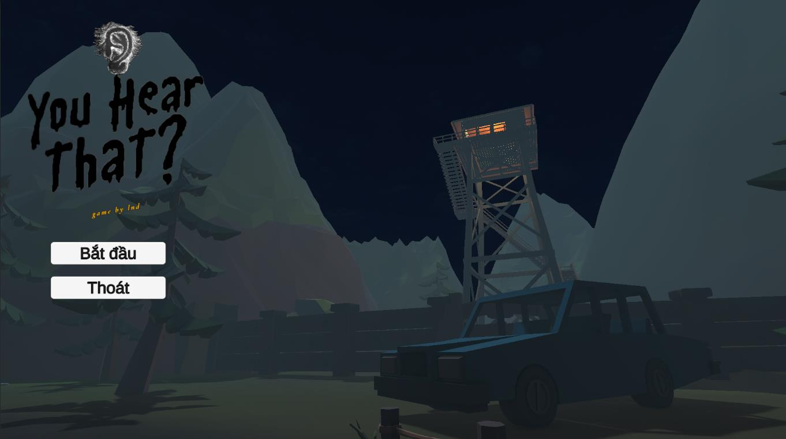
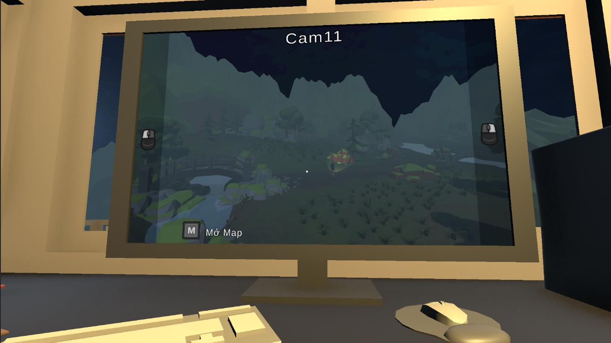
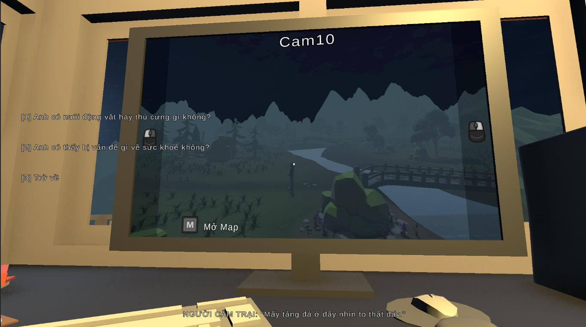
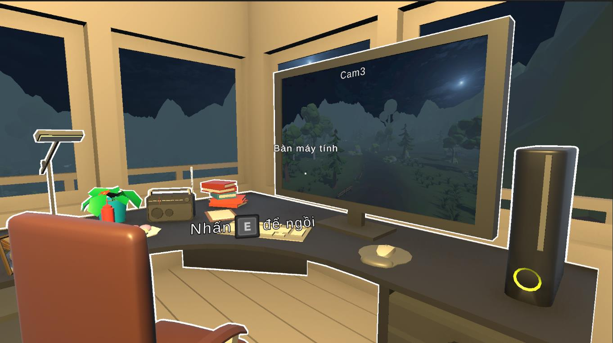
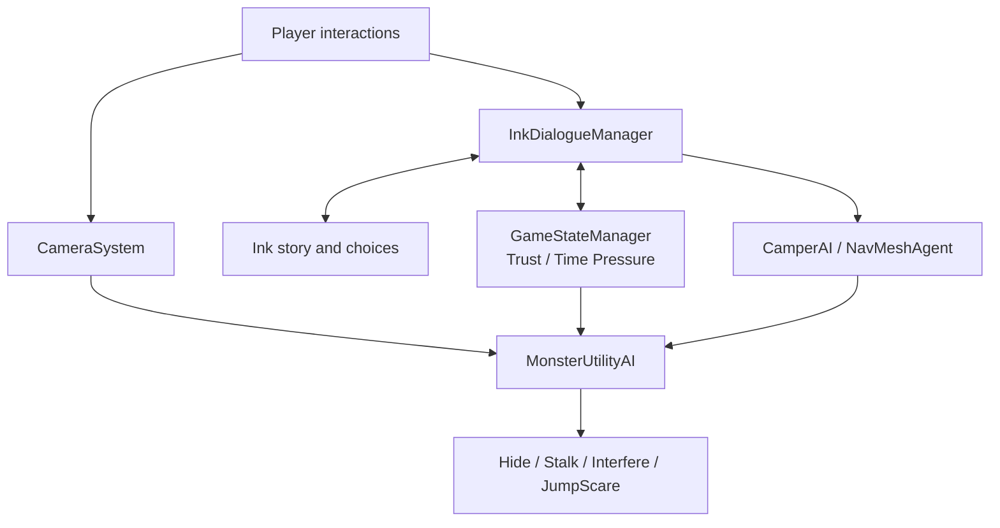
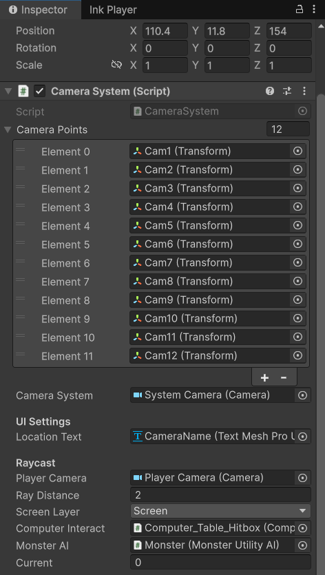
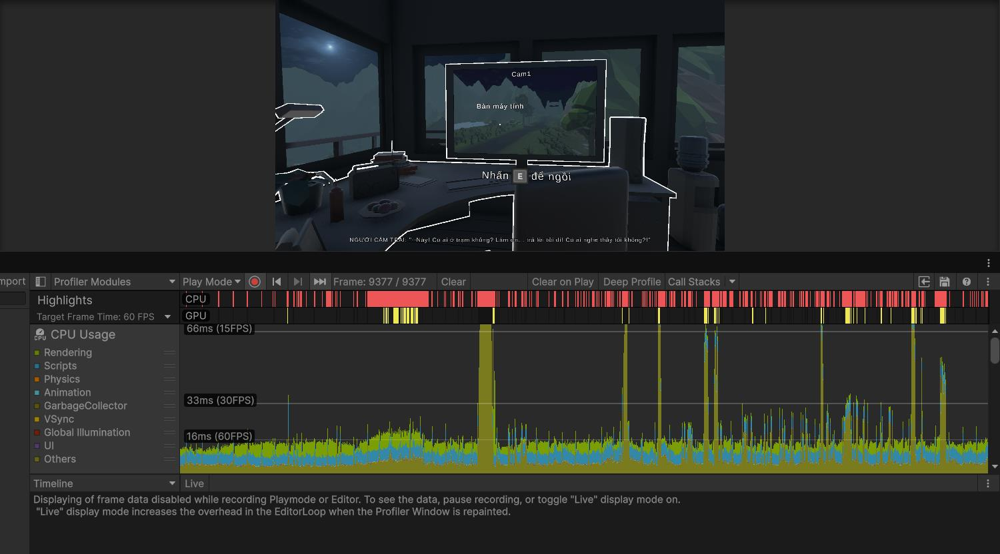

# YOU HEAR THAT?
### A first-person psychological horror game built with Unity

**Solo Graduation Project (2026)** · **Unity / C# / URP / Ink / NavMesh**

## Download & Play

**You Hear That? — Windows PC**

[Download the game on itch.io](https://lnduongg.itch.io/you-hear-that)

[Watch Gameplay Demo](https://www.youtube.com/watch?v=E_q-wjqsOGI) · [Developer GitHub](https://github.com/lnduongg)

> **Language Notice:** The game currently supports Vietnamese only.
> English localization is not yet available.

### How to Play
1. Download the Windows ZIP file.
2. Extract the archive.
3. Run YouHearThat.exe.

### Platform
- Windows 10/11 (64-bit)
- Keyboard and Mouse

## Overview

*You Hear That?* is a 3D psychological horror game about a night-shift forest ranger who must guide a lost camper over the radio while monitoring 12 surveillance viewpoints. Players make decisions using incomplete information as a mysterious presence interferes with the camera network and their rescue attempt.

The project combines **indirect player interaction**, **branching dialogue**, **visibility-aware enemy behavior**, and **in-world (diegetic) interfaces**. Different choices and game-state conditions lead to good, bad, or secret outcomes.

## Gameplay Screenshots

| Surveillance camera | Radio dialogue |
|:--:|:--:|
|  |  |
| CCTV monitoring system | Ink-powered dialogue UI |

*Screenshots extracted from the author's 2026 graduation report. Animated demonstrations of camera switching and monster behavior are not included yet.*

## My Role

This was my **university graduation project**, developed as an individual project. I worked on gameplay programming and systems integration, including:

- Surveillance-camera interactions and Render Texture display
- Monster behavior selection using a utility-based scoring model
- Radio dialogue and story-event integration with Ink
- Camper navigation using Unity NavMeshAgent and waypoints
- Global game-state variables for Trust and Time Pressure
- Player interaction, in-world UI, gameplay testing, and performance inspection

## Technical Highlights

### 1. Utility-based Monster AI

The monster periodically evaluates possible behaviors instead of using a single hard-coded action sequence. `MonsterAction` combines `Consideration` scores, with concrete factors including distance, time pressure, visibility, NPC movement, and unpredictability. These are configurable through ScriptableObject-based considerations and response curves.

Available behaviors include **Hide**, **Stalk**, **Interfere**, and **JumpScare**. Visibility checks help restrict unexpected movements when the player can observe the monster. Details: [Monster AI Breakdown](docs/MONSTER_AI.md).

### 2. 12-Viewpoint Surveillance System

Rather than rendering 12 separate active cameras, `CameraSystem` repositions **one rendering camera** among 12 configured observation points and displays its output on an in-world monitor via Render Texture. The player switches viewpoints through interactions with the screen. Details: [Camera System Breakdown](docs/CAMERA_SYSTEM.md).

### 3. Ink-Driven Narrative & Gameplay

Ink handles story passages, dialogue choices, and branching logic. The Unity-side dialogue manager processes story tags and synchronizes the script with NPC movement, audio cues, gameplay events, and state variables. **Trust** and **Time Pressure** influence narrative outcomes and gameplay behavior. Details: [Ink Integration Breakdown](docs/INK_INTEGRATION.md).

## Architecture at a Glance

*Simplified diagram of the main gameplay relationships; not a complete UML dependency map.*

## Development Screenshots

| Surveillance camera setup | Unity Profiler |
|:--:|:--:|
|  |  |

*More implementation evidence is documented in the technical breakdowns linked below.*

## Reported Testing & Performance

The graduation report documents functional tests for camera switching, object interaction, NPC navigation, key collection, AI camera interference, and secret-ending activation. It also reports testing on an **Acer Nitro 5 with an RTX 3050 Laptop GPU**, with approximately **60–75 FPS** during typical gameplay and dips to around **55 FPS** during rapid camera switches.

These values are **reported observations from the graduation project**, not independently reproduced benchmarks or an A/B measurement of GPU optimization. See [Testing and Limitations](docs/TESTING.md).

## Screenshots & Playable Demo

- **Gameplay video:** [YouTube demo](https://www.youtube.com/watch?v=E_q-wjqsOGI)
- **Gameplay screenshots:** See the Gameplay Screenshots section above (extracted from the graduation report)
- **Playable Windows build:** To be added after packaging and verification
- **Code samples:** To be added after code cleanup and dependency/asset review

## Project Status

The graduation report describes a completed playable build with multiple endings. The project remains a **portfolio / academic release**, rather than a commercially shipped game.

## Further Reading

- [Monster AI: scoring & visibility checks](docs/MONSTER_AI.md)
- [Surveillance system: a single active rendering camera](docs/CAMERA_SYSTEM.md)
- [Ink and Unity integration](docs/INK_INTEGRATION.md)
- [Testing, profiler data & limitations](docs/TESTING.md)

## Contact

**Luyen Ngoc Duong** — Unity Developer / Gameplay Programmer  
GitHub: https://github.com/lnduongg  
Email: lnd270403@gmail.com

---
*Built as a 2026 Information Technology graduation project at Thuy Loi University.*
