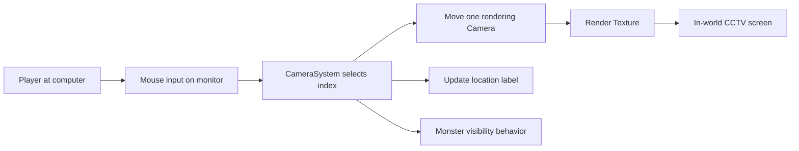

# Technical Breakdown — 12-Viewpoint Surveillance

## Problem

The player needs to monitor multiple places in a forest without necessarily rendering a separate live image for all 12 locations simultaneously.

*Figure 5-3: in-game camera monitoring screen.*

*Figure 4-2: surveillance viewpoints in the Unity editor.*

## Design

`CameraSystem.cs` keeps an array of camera point transforms and moves **one Unity Camera** between these transforms when the player selects another viewpoint. The camera output is shown on a physical monitor using Render Texture, creating an in-world surveillance interface.

## Implementation Highlights

- Configured viewpoint positions are represented by `Transform[] cameraPoints`.
- `CameraSystem` uses a screen-layer physics raycast to gate camera switching while the player is using the computer.
- The current camera position and rotation are set with `SetPositionAndRotation`.
- A TextMeshPro UI label displays the selected location name.
- Camera selection is connected with monster visibility/hidden movement logic.

## Tradeoffs

This is **12 selectable viewpoints driven by one active rendering camera**, not 12 fully independent cameras streaming simultaneously. The approach limits surveillance rendering work, but rapid switching can still involve scene/rendering overhead.

## Improvement Opportunities

- Make both left and right viewpoint switches invoke consistent visibility handling (the current scripts call `ProcessQuantumHiding` explicitly on the left branch only; a separate update-based check also exists).
- Add validation for empty viewpoint arrays and missing references.
- Capture before/after profiler measurements if claiming a numerical optimization benefit.

## Evidence

Source: `CameraSystem.cs`, `MonsterUtilityAI.cs`, `ComputerInteract.cs`. Graduation report sections 3.5.3 and 4.2; performance notes in section 5.4.
