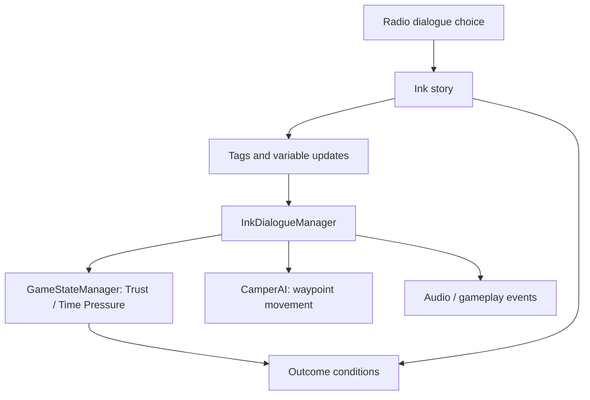

# Technical Breakdown — Ink-Driven Narrative and Gameplay

## Design Goal

Connect a branching horror story to the physical state of the game: what the camper does, what the player knows, and how threatening the situation becomes.

*Figure 5-4: player radio interaction.*

*Figure 5-5: debugging view of Trust and Time Pressure.*

## Implementation

The game uses an Ink story file (`You Hear That.ink`) and a Unity dialogue manager (`InkDialogueManager.cs`). The script owns much of the narrative choice structure, while Unity handles in-game side effects.

## Narrative Systems

- Branching choices vary based on story progression and player decisions.
- `GameStateManager` tracks Trust and Time Pressure, variables used to influence gameplay and story logic.
- Story commands/tags coordinate NPC navigation and other in-game events.
- The report documents Good, Bad, and Secret ending categories; the Ink file includes multiple named ending branches.

## Engineering Considerations

Keeping narrative content in Ink helps avoid encoding every line and branch as C# conditionals. However, the dialogue manager currently coordinates UI, audio, branching state, and events, which can make it hard to test and maintain.

**Future refactor:** split tag parsing, presentation, game-state synchronization, and event dispatch into smaller components; validate unknown tags; add regression tests for critical ending paths.

## Evidence

Source: `InkDialogueManager.cs`, `GameStateManager.cs`, `CamperAI.cs`, `You Hear That.ink`. Graduation report sections 3.3, 3.4, 3.7, and 4.3.
