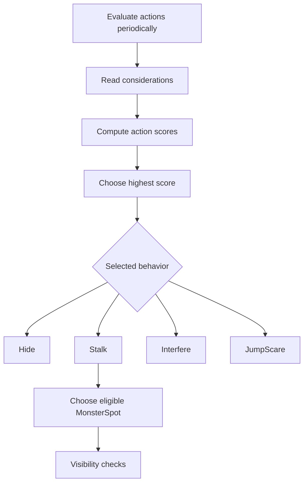

# Technical Breakdown — Utility-based Monster AI

## Problem

A predefined sequence of scares would make the monster predictable. The goal was to select behaviors based on the changing game situation while avoiding visible, implausible repositioning.

## Implementation

The provided scripts contain `MonsterUtilityAI.cs`, `MonsterAction.cs`, and `Consideration.cs` with subclasses such as `DistanceConsideration`, `VisibilityConsideration`, `TimePressureConsideration`, `NPCMovementConsideration`, and `UnpredictableConsideration`.

1. `MonsterUtilityAI` evaluates available actions on an interval (configured as 15 seconds by default).
2. Each `MonsterAction` combines scores returned by its `Consideration` entries.
3. The best-scoring action is selected among the configured candidates.
4. The monster executes the corresponding behavior: `Hide`, `Stalk`, `Interfere`, or `JumpScare`.
5. Visibility checks and predefined `MonsterSpot` locations constrain repositioning.

## Design Details

- Considerations are implemented through Unity ScriptableObject-derived assets, enabling configuration without putting all tuning rules inside the main AI component.
- The `MonsterAction.Evaluate` implementation multiplies consideration scores and applies a correction term to the result. A zero-valued consideration can suppress an action.
- The monster checks whether it is visible before some decisions and uses camera viewpoint and viewport checks for its hiding/repositioning logic.
- `Interfere` temporarily sets a broken-camera identifier for roughly 5–10 seconds, controlled by a coroutine.

## What I Would Improve Next

- Replace string comparisons of action names with typed identifiers or polymorphic action implementations.
- Handle zero configured considerations in score calculation.
- Add automated tests for score ranges, invalid references, and visibility edge cases.
- Profile the overhead of camera and visibility checks during repeated rapid switches.

## Evidence

Source files: `MonsterUtilityAI.cs`, `MonsterAction.cs`, `Consideration.cs` and subclasses. Graduation report sections 3.5 and 4.4.2.
